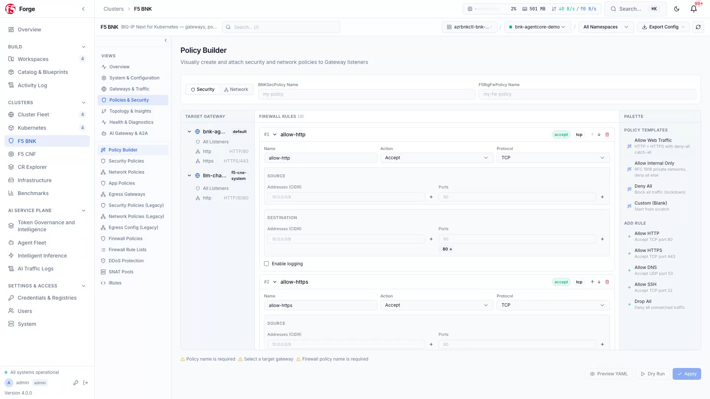
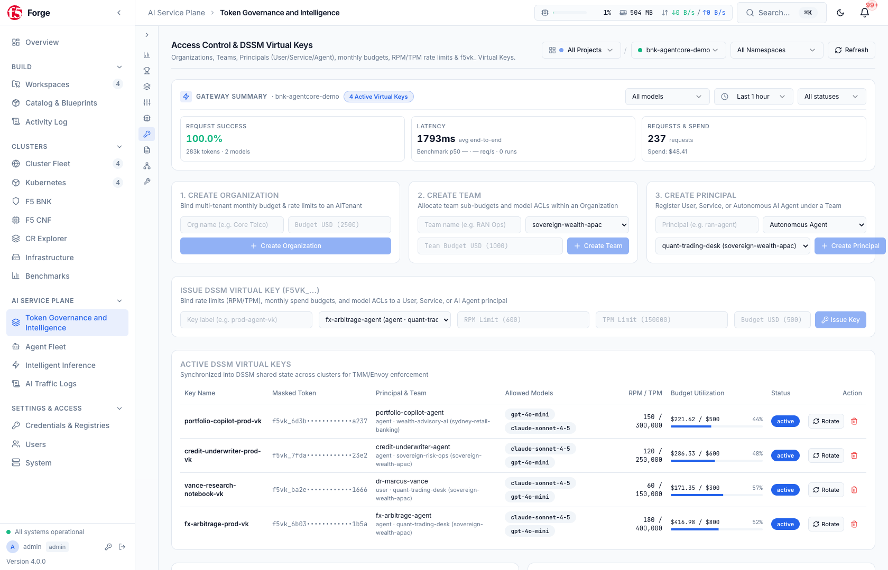
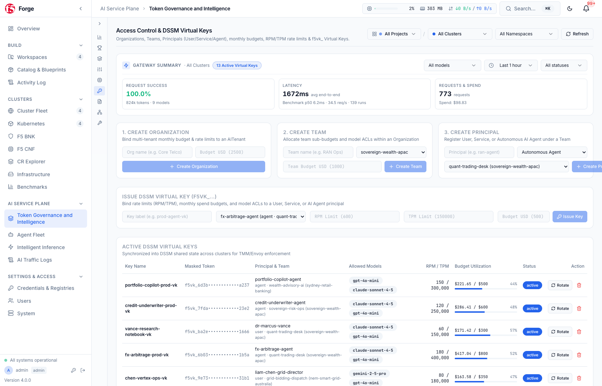
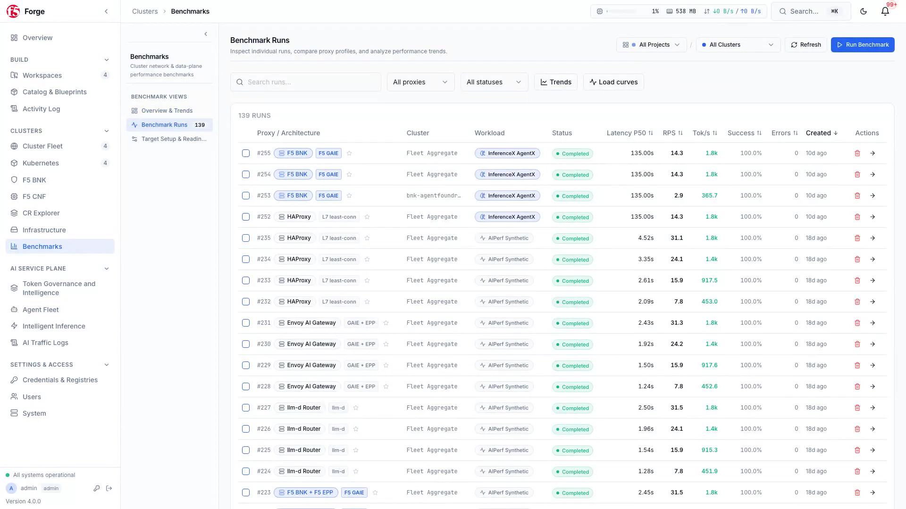

# `awsbnkctl` — AWS EKS F5 BIG-IP Next for Kubernetes (BNK) Engine

[](go.mod)
[](LICENSE)
[](#the-bnkctl-multi-cloud-family)

`awsbnkctl` is a **pure-Go lifecycle and validation CLI** for deploying, operating, upgrading, benchmarking, and tearing down **F5 BIG-IP Next for Kubernetes (BNK)** and **F5 BNK AI Service Plane** estates on **Amazon EKS** (including **AWS Local Zones**) — with native integration into [**F5 BNK Forge**](https://github.com/JLCode-tech/bnk-forge).

> **Preferred Multi-Cloud CLI**: [**`bnkctl`**](https://github.com/JLCode-tech/bnkctl) is the **preferred unified multi-cloud CLI** for deploying F5 BNK across **AWS EKS**, **Azure AKS**, and **Google Cloud GKE** from a single binary. `awsbnkctl` is the standalone AWS-pinned CLI in the same family and shares the same engine, command surface, and declarative `cluster.yaml` model.


---

## Why `awsbnkctl`?

Deploying a **BIG-IP Next for Kubernetes (BNK)** and **F5 BNK AI Service Plane** on Amazon EKS traditionally requires stitching together cloud-specific Terraform modules, CNI plumbing, secondary ENI attachments, BGP route servers, Helm charts, and post-install reconciliations.

`awsbnkctl` replaces that complexity with **one declarative `cluster.yaml` intent file** and **one pure-Go engine**:

- **Part of the `bnkctl` Family**: Shares the same architecture and CLI experience as [**`bnkctl`**](https://github.com/JLCode-tech/bnkctl) (the preferred unified multi-cloud CLI), [**`azrbnkctl`**](https://github.com/JLCode-tech/azrbnkctl), and [**`gkebnkctl`**](https://github.com/JLCode-tech/gkebnkctl).
- **Pure AWS & Kubernetes SDKs**: Provisions VPCs, public/private/data-plane subnets (including AWS Local Zones), multi-NIC worker node groups, security groups, NAT gateways, AWS Route Server BGP peering, and Amazon EKS clusters directly via `aws-sdk-go-v2`, `client-go`, and the Helm v3 Go SDK.
- **Version-Aware BNK Release Catalog**: Built-in support for BNK **2.3.x** (`legacy-spk`), **2.4.0**, **2.4.1**, and **future release** (`gateway-infra`), including automatic release-quirk self-healing (`awsbnkctl heal`) and cross-train migration (`awsbnkctl migrate`). See the [F5 BIG-IP Next for Kubernetes CloudDocs](https://clouddocs.f5.com/bigip-next-for-kubernetes/latest/overview.html) for full platform documentation.
- **Turnkey BNK Forge & F5 BNK AI Service Plane**: Automatically registers clusters with [**F5 BNK Forge**](https://github.com/JLCode-tech/bnk-forge) during `awsbnkctl up`, seeds AI Token Governance and Smart LLM Routing for **AWS Bedrock & AgentCore**, and cleans up on `awsbnkctl down`.
- **Zero-Leak Teardown**: Deterministic reverse-dependency teardown (`awsbnkctl down`) strips stuck Kubernetes finalizers, removes cloud load balancers and secondary ENIs, deletes the EKS cluster and VPC underlay, and unregisters from [BNK Forge](https://github.com/JLCode-tech/bnk-forge).

---

## The `bnkctl` Multi-Cloud Family

[**`bnkctl`**](https://github.com/JLCode-tech/bnkctl) is the preferred unified CLI across all three hyperscalers, while `awsbnkctl`, `azrbnkctl`, and `gkebnkctl` provide standalone single-cloud binaries:

| CLI & Repository | Status | Target Cloud | Default Underlay & Dataplane Architecture |
| :--- | :--- | :--- | :--- |
| [**`bnkctl`**](https://github.com/JLCode-tech/bnkctl) | **Preferred (Unified)** | **AWS, Azure, GCP** | Auto-detects cloud provider from `cluster.yaml` (`apiVersion` or `cloud.provider`) or `--cloud aws\|azure\|gcp`. |
| [**`awsbnkctl`**](https://github.com/JLCode-tech/awsbnkctl) | Single-Cloud (AWS) | **AWS EKS** | VPC + Public/Private/DataPath Subnets (including AWS Local Zones), Multus + `host-device` / SR-IOV secondary ENIs, AWS Route Server BGP peering. |
| [**`azrbnkctl`**](https://github.com/JLCode-tech/azrbnkctl) | Single-Cloud (Azure) | **Azure AKS** | VNet + System & TMM Node Pools, Accelerated Networking (`dual-interface`), dynamic secondary NIC attachment, VXLAN egress / L4 load balancing. |
| [**`gkebnkctl`**](https://github.com/JLCode-tech/gkebnkctl) | Single-Cloud (GCP) | **GCP GKE** | Multi-VPC (`main`, `external`, `internal`) with Jumbo Frames (MTU 8896), GKE multi-network pod attachments (`virtio`), Cloud NAT & IAP jumphost. |

---

## What You Can Build with `awsbnkctl` + [BNK Forge](https://github.com/JLCode-tech/bnk-forge)

When `forge.enabled: true` is set in your `cluster.yaml`, `awsbnkctl up` automatically bridges your Amazon EKS cluster into [**BNK Forge**](https://github.com/JLCode-tech/bnk-forge) — giving you a visual control plane for BNK lifecycle, security policy authoring, AI token governance, and LLM benchmarking.

### 1. Unified Multi-Cloud Cluster Fleet & Blueprints Catalog

As soon as `awsbnkctl up` completes Forge registration, your Amazon EKS cluster appears in the [**BNK Forge**](https://github.com/JLCode-tech/bnk-forge) **Cluster Fleet** alongside your multi-cloud estate with live data-plane telemetry, active listeners, L4/L7 routes, and one-click deployable **Blueprints**.


### 2. Visual Network Security & Traffic Policy Management

Author, visualize, and enforce L4/L7 traffic routing, carrier-grade network translation, DNS delivery, and zero-trust security policies across your Kubernetes clusters from a single visual interface or declaratively via `awsbnkctl`. For complete details on F5 BIG-IP Next for Kubernetes traffic and security capabilities, see the [F5 BIG-IP Next for Kubernetes CloudDocs](https://clouddocs.f5.com/bigip-next-for-kubernetes/latest/overview.html).



### 3. F5 BNK AI Service Plane: Token Governance & Data Guardrails

Deliver enterprise-grade AI traffic governance on AWS with real-time token accounting, budget and rate enforcement, sensitive data (PII/DLP) guardrails, and prompt-injection protection managed through [**BNK Forge**](https://github.com/JLCode-tech/bnk-forge). Learn more about F5's cloud-native data plane and AI traffic capabilities in the [F5 BIG-IP Next for Kubernetes CloudDocs](https://clouddocs.f5.com/bigip-next-for-kubernetes/latest/overview.html).





### 4. Smart LLM Router Fleet for AWS Bedrock & AgentCore

Route agentic and inference traffic across primary and fallback foundation models in **AWS Bedrock** (Claude Sonnet / Haiku) and **Bedrock AgentCore** — complete with Model Context Protocol (MCP) tool security and weighted failover:


### 5. Automated GenAI & Dataplane Benchmarking (`aiperf` + 15 Built-in Scenarios)

Compare throughput, Time-to-First-Token (TTFT), Inter-Token Latency (ITL), and token-rate enforcement across **F5 BNK + F5 GAIE**, Envoy, HAProxy, and `llm-d` Router, or run any of the 15 built-in Kubernetes validation scenarios (`awsbnkctl scenarios run`):



### 6. AI-Assisted Day-2 Operations via 153 MCP Server Tools

Every cluster registered by `awsbnkctl` can be inspected, diagnosed, and operated through [BNK Forge](https://github.com/JLCode-tech/bnk-forge)'s built-in **Model Context Protocol (MCP) Server**, exposing 153 structured tools for AI assistants and automation pipelines:


---

## Quickstart

### Prerequisites

1. **Go 1.26+** (to build from source) or a pre-built release binary from [GitHub Releases](https://github.com/JLCode-tech/awsbnkctl/releases).
2. **F5 BIG-IP Next for Kubernetes License & Registry Access** (gitignored locally; never committed):
   - Follow the [F5 BIG-IP Next for Kubernetes CloudDocs](https://clouddocs.f5.com/bigip-next-for-kubernetes/latest/overview.html) to obtain your F5 subscription JWT (`license.jwt`) and configure F5 Artifact Registry (`repo.f5.com`) pull credentials.
3. **AWS Credentials**:
   - AWS CLI / SSO profile (`aws sts get-caller-identity`) with permissions for EKS, EC2/VPC, IAM, and CloudFormation.

### 1. Build the CLI

```bash
git clone https://github.com/JLCode-tech/awsbnkctl.git
cd awsbnkctl
go build -o ./awsbnkctl ./cmd/awsbnkctl
```

### 2. Validate & Dry-Run Any Example Offline

You can validate any `cluster.yaml` and preview the full AWS underlay + BNK overlay execution plan without touching live AWS APIs:

```bash
# AWS EKS + Bedrock AgentCore + F5 BNK AI Service Plane (2.4.1)
./awsbnkctl validate -c examples/agentcore-demo/cluster.yaml
./awsbnkctl up -c examples/agentcore-demo/cluster.yaml --dry-run

# AWS Local Zone Low-Latency Edge BNK (Boston us-east-1-bos-1a)
./awsbnkctl validate -c examples/local-zone-boston/cluster.yaml
./awsbnkctl up -c examples/local-zone-boston/cluster.yaml --dry-run
```

### 3. Deploy End-to-End (`awsbnkctl up`)

```bash
# Deploy using awsbnkctl (or use the preferred unified `bnkctl up -c ...`)
./awsbnkctl up -c examples/agentcore-demo/cluster.yaml
```

### 4. Inspect, Heal, Benchmark & Teardown

```bash
# Check AWS underlay, TMM dataplane, BNK release profile, and active quirks
./awsbnkctl status -c examples/agentcore-demo/cluster.yaml

# Run BNK release-quirk self-healing and route pool resync
./awsbnkctl heal -c examples/agentcore-demo/cluster.yaml
./awsbnkctl bnk resync -c examples/agentcore-demo/cluster.yaml

# Verify BNK Forge registration & F5 BNK AI Service Plane governance readiness
./awsbnkctl forge status -c examples/agentcore-demo/cluster.yaml
./awsbnkctl forge governance overview -c examples/agentcore-demo/cluster.yaml

# Run validation scenarios (L4 TCP/UDP, gRPC, HTTP routing, Egress SNAT, AI Token Counting)
./awsbnkctl scenarios list
./awsbnkctl scenarios run http-routing-e2e -c examples/agentcore-demo/cluster.yaml

# Tear down all AWS & cluster resources cleanly with zero leaked ENIs/VPCs
./awsbnkctl down -c examples/agentcore-demo/cluster.yaml
```

---

## Command Reference

| Command | Description |
| :--- | :--- |
| `awsbnkctl up` | Provision AWS underlay (VPC, subnets, EKS cluster, secondary ENIs, Route Server BGP) and deploy the BNK overlay stack + [BNK Forge](https://github.com/JLCode-tech/bnk-forge) registration |
| `awsbnkctl down` | Tear down BNK overlay, strip stuck finalizers, unregister from [BNK Forge](https://github.com/JLCode-tech/bnk-forge), and destroy all AWS underlay resources |
| `awsbnkctl status` | Inspect AWS underlay state, BNK release train/profile, TMM dataplane readiness, and active release quirks |
| `awsbnkctl validate` | Validate `cluster.yaml` intent and dry-run render all BNK overlay manifests |
| `awsbnkctl doctor` | Verify local prerequisites, AWS credentials, registry pull credentials, and subscription JWT validity |
| `awsbnkctl heal` | Run idempotent BNK self-healing and version-specific quirk reconciliations |
| `awsbnkctl upgrade` | Upgrade BNK overlay in-place within the same architectural release train |
| `awsbnkctl migrate` | Migrate BNK overlay across architectural release boundaries (e.g., `2.3.x legacy-spk` -> `2.4.x/future gateway-infra`) |
| `awsbnkctl bnk {status,scan,heal,resync,upgrade,migrate}` | Granular BNK overlay inspection, MCP endpoint scanning, and pool-member resynchronization |
| `awsbnkctl forge {register,unregister,status,governance}` | Register/unregister clusters with [BNK Forge](https://github.com/JLCode-tech/bnk-forge) and manage F5 BNK AI Service Plane governance |
| `awsbnkctl scenarios {list,show,run}` | List, inspect, and execute 15 built-in BNK L4/L7, egress, and GenAI validation scenarios |
| `awsbnkctl test {connectivity,dns}` | Execute TCP/UDP VIP connectivity and DNS probes from the cluster jumphost or probe pod |
| `awsbnkctl genai parse` | Parse `aiperf` benchmark artifacts into structured [BNK Forge](https://github.com/JLCode-tech/bnk-forge) GenAI telemetry |
| `awsbnkctl k` | In-process Kubernetes `client-go` operations with automatic cluster template variable rendering |
| `awsbnkctl topology` | Render cluster network and TMM dataplane interface topology |

---

## Example AWS Blueprints (`examples/`)

| Directory | Region / Zone | Architecture & Use Case |
| :--- | :--- | :--- |
| [`examples/agentcore-demo/`](examples/agentcore-demo/) | **AWS EKS (`ap-southeast-2`)** | Full F5 BNK AI Service Plane (2.4.1) + AWS Bedrock AgentCore + MCP Tool Security + AWS Route Server BGP |
| [`examples/full-cluster/`](examples/full-cluster/) | **AWS EKS** | Standard multi-NIC EKS deployment with external/internal data-plane subnets and BGP |
| [`examples/egress-demo/`](examples/egress-demo/) | **AWS EKS** | Egress SNAT, pseudo-CGNAT, and deterministic outbound routing validation |
| [`examples/local-zone-boston/`](examples/local-zone-boston/) | **AWS Local Zone (`us-east-1-bos-1a`)** | Low-latency Edge BNK deployment (`host-device` data path) |
| [`examples/local-zone-losangeles/`](examples/local-zone-losangeles/) | **AWS Local Zone (`us-west-2-lax-1a`)** | Low-latency Edge BNK deployment in Los Angeles |
| [`examples/local-zone-hamburg/`](examples/local-zone-hamburg/) | **AWS Local Zone (`eu-central-1-ham-1a`)** | Low-latency Edge BNK deployment in Hamburg |
| [`examples/local-zone-warsaw/`](examples/local-zone-warsaw/) | **AWS Local Zone (`eu-central-1-waw-1a`)** | Low-latency Edge BNK deployment in Warsaw |
| [`examples/local-zone-perth/`](examples/local-zone-perth/) | **AWS Local Zone (`ap-southeast-2-per-1a`)** | Low-latency Edge BNK deployment in Perth |
| [`examples/local-zone-manila/`](examples/local-zone-manila/) | **AWS Local Zone (`ap-southeast-1-mnl-1a`)** | Low-latency Edge BNK deployment in Manila |

---

## Documentation Index

- [**Unified Multi-Cloud CLI (`JLCode-tech/bnkctl`)**](https://github.com/JLCode-tech/bnkctl) — The preferred unified multi-cloud CLI for AWS EKS, Azure AKS, and Google Cloud GKE.
- [**Architecture & Design (`docs/ARCHITECTURE.md`)**](docs/ARCHITECTURE.md) — AWS EKS underlay, secondary ENI plumbing, and BNK overlay architecture.
- [**BNK Forge & F5 BNK AI Service Plane Integration (`docs/FORGE_INTEGRATION.md`)**](docs/FORGE_INTEGRATION.md) — Visual walkthrough of [BNK Forge](https://github.com/JLCode-tech/bnk-forge) cluster registration, policy building, AI token governance, and Smart LLM Routing.
- [**Commands Reference (`docs/COMMANDS.md`)**](docs/COMMANDS.md) & [**Validation Scenarios (`docs/SCENARIOS.md`)**](docs/SCENARIOS.md) — Detailed CLI flags and 15 built-in validation scenarios.
- [**F5 BIG-IP Next for Kubernetes CloudDocs**](https://clouddocs.f5.com/bigip-next-for-kubernetes/latest/overview.html) — Official F5 product documentation, architecture guides, and prerequisite setup.

---

## License

Released under the [MIT License](LICENSE).
