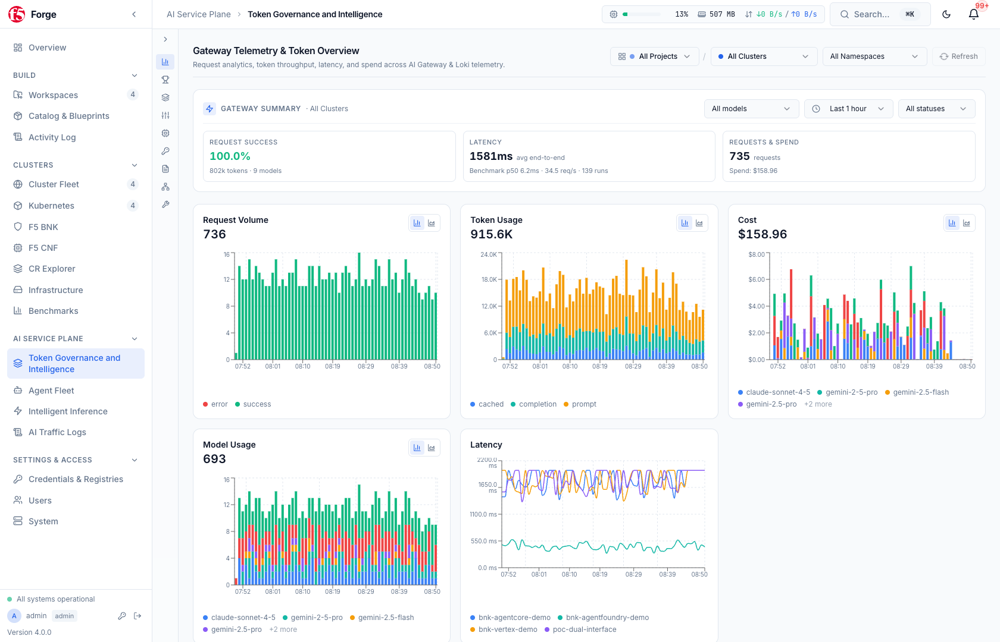
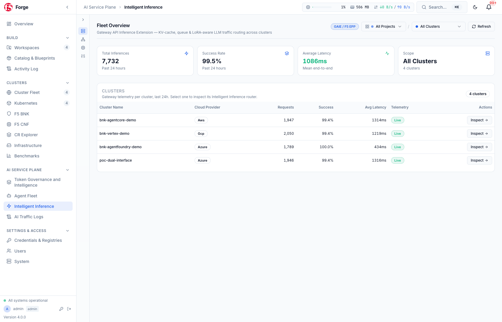
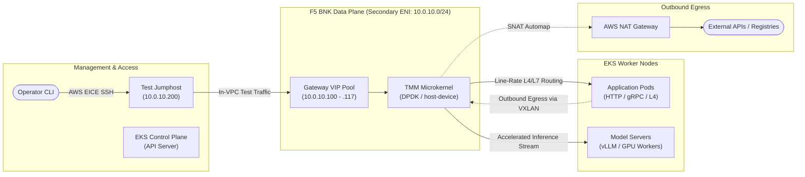
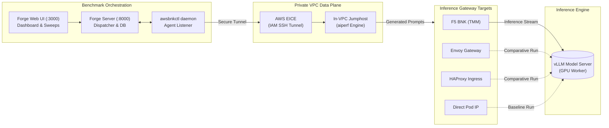
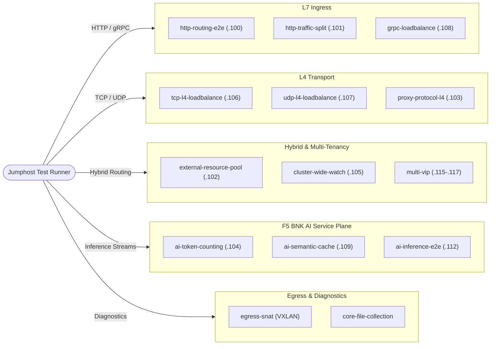
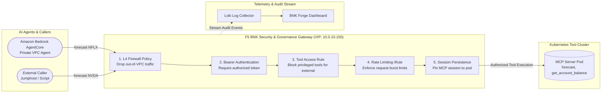

# awsbnkctl


[](https://github.com/JLCode-tech/awsbnkctl/actions/workflows/ci.yml)
[](https://github.com/JLCode-tech/awsbnkctl/releases)
[](LICENSE)

**Deploy, operate, and benchmark F5 BIG-IP Next for Kubernetes (BNK) on AWS EKS from a single binary.**  
Zero Terraform. Zero host `kubectl`. Zero host `helm`.

---

`awsbnkctl` automates the entire lifecycle of enterprise F5 BNK deployments on AWS EKS. From a single declarative `cluster.yaml`, it provisions the AWS VPC, EKS cluster, secondary data-plane ENIs, Multus CNI attachments, hugepages, and the full F5 BNK 2.4 (`2.4.0` / `2.4.1`) software stack. It includes **15 built-in automated traffic validation scenarios**, an enterprise **AI inference benchmarking suite** (`aiperf`), **native [BNK Forge](https://github.com/JLCode-tech/bnk-forge) integration**, and **ready-to-deploy AWS Local Zone & F5 BNK AI Service Plane topologies**.

---

## Table of Contents

- [Why awsbnkctl?](#why-awsbnkctl)
- [What You Can Build with awsbnkctl + BNK Forge](#what-you-can-build-with-awsbnkctl--bnk-forge)
- [System Architecture & Network Topology](#system-architecture--network-topology)
- [AI Inference Benchmarking & Comparative Shootouts](#ai-inference-benchmarking--comparative-shootouts)
- [15 Built-in Validation Scenarios](#15-built-in-validation-scenarios)
- [Architecture & Protocol Demos](#architecture--protocol-demos)
- [AWS Local Zones & Hybrid Topologies](#aws-local-zones--hybrid-topologies)
- [Quick Start](#quick-start)
- [Interface Patterns](#interface-patterns)
- [Pinned Ecosystem Versions](#pinned-ecosystem-versions)
- [CLI Command Taxonomy](#cli-command-taxonomy)
- [Documentation & The `*bnkctl` Family](#documentation--the-bnkctl-family)

---

## Why awsbnkctl?

Deploying F5 BIG-IP Next for Kubernetes (BNK) on AWS typically requires coordinating multiple infrastructure layers:
- AWS VPC networking with dedicated subnets, route tables, and secondary Elastic Network Interfaces (ENIs).
- EKS cluster lifecycle, OIDC identity providers, and least-privilege IAM roles for service accounts (IRSA).
- Host-level Linux kernel tuning: hugepages reservation, DPDK/host-device attachment, and Multus CNI daemonsets.
- Cloud-native F5 control-plane lifecycle and Kubernetes Gateway API traffic and security management (see the [F5 BIG-IP Next for Kubernetes CloudDocs](https://clouddocs.f5.com/bigip-next-for-kubernetes/latest/overview.html)).
- Live data-plane traffic validation inside private subnets without exposing workloads to the public internet.

`awsbnkctl` consolidates this entire workflow into a **single, dependency-free binary**:

- **Zero Prerequisites**: No Terraform, Helm, or external `kubectl` required on the host—everything is driven natively via AWS SDK for Go v2 and client-go.
- **Deterministic State Machine**: 41 sequential phases execute with full idempotency, resume safety, and explicit state verification.
- **Built-in Diagnostics & Healing**: The `awsbnkctl bnk heal` command detects and automatically remediates 11 common Kubernetes plumbing issues (token expiration, metrics-server bindings, Multus mounts, EPP watched namespaces, and RBAC policies).
- **In-VPC Validation**: 15 built-in automated test scenarios validate L4/L7 routing, canary splits, gRPC streams, and AI inference directly inside the VPC.
- **Clean, Stateless Teardown**: Tag-driven AWS resource discovery (`HydrateMissingStateFromAWS`) plus pre-teardown Kubernetes CRD finalizer and EBS CSI PVC cleanup ensures `awsbnkctl down -f cluster.yaml --yes` destroys 100% of provisioned AWS resources with zero orphaned remnants—even if local `.awsbnkctl/state.env` was deleted.

---

## What You Can Build with `awsbnkctl` + [BNK Forge](https://github.com/JLCode-tech/bnk-forge)

When `forge.enabled: true` is configured in `cluster.yaml`, `awsbnkctl` automatically registers your AWS EKS cluster with [**BNK Forge**](https://github.com/JLCode-tech/bnk-forge) (Phase 09), seeds its **AI Governance & Token Accounting** configuration (`EnsureClusterAIGovernanceConfig`), and indexes your cluster's L4/L7 traffic routing and **F5 BNK AI Service Plane** posture.

### 1. Multi-Cloud Cluster Fleet & Real-Time BNK Telemetry
Register and monitor AWS EKS clusters alongside Azure AKS and GCP GKE from a single control plane. `awsbnkctl` hands off a bootstrap kubeconfig and seeds the cluster's Loki (`http://loki.llm-egress.svc.cluster.local:3100`) and Prometheus endpoints automatically.

| Platform Overview | Multi-Cloud Cluster Fleet |
|---|---|
|  |  |

### 2. Visual Network Security & Traffic Policy Management
Author, visualize, and enforce L4/L7 traffic routing, carrier-grade network translation, DNS delivery, and zero-trust security policies across your Kubernetes clusters from a single visual interface or declaratively via `awsbnkctl`. For complete details on F5 BIG-IP Next for Kubernetes traffic and security capabilities, see the [F5 BIG-IP Next for Kubernetes CloudDocs](https://clouddocs.f5.com/bigip-next-for-kubernetes/latest/overview.html).

| Blueprints Catalog | Visual BNK Policy Builder |
|---|---|
|  |  |

### 3. F5 BNK AI Service Plane: Token Governance & Data Guardrails
Deliver enterprise-grade AI traffic governance with real-time token accounting, budget and rate enforcement, sensitive data (PII/DLP) guardrails, and prompt-injection protection managed through [**BNK Forge**](https://github.com/JLCode-tech/bnk-forge). Learn more about F5's cloud-native data plane and AI traffic capabilities in the [F5 BIG-IP Next for Kubernetes CloudDocs](https://clouddocs.f5.com/bigip-next-for-kubernetes/latest/overview.html).

| AI Token Governance Overview | AI Governance Guardrails |
|---|---|
|  |  |

| AWS EKS Governance & Token Accounting | MCP Server Tool Discovery & Access Control |
|---|---|
|  |  |

### 4. Smart LLM Router Pools, Topology & `aiperf` Benchmarking
Route inference traffic across Amazon Bedrock, in-cluster vLLM GPU pools, and multi-cloud model endpoints while measuring real-time TTFT, ITL, and token throughput with `awsbnkctl benchmark`.

| AWS LLM Router Pools | Smart LLM Router Fleet |
|---|---|
|  |  |

| Interactive LLM Router Topology | `aiperf` Benchmark Dashboard |
|---|---|
|  |  |

*(See [`docs/FORGE_INTEGRATION.md`](docs/FORGE_INTEGRATION.md) for the complete [BNK Forge](https://github.com/JLCode-tech/bnk-forge) setup, AI governance seeding, and benchmark daemon guide.)*

---

## System Architecture & Network Topology

`awsbnkctl` provisions an AWS VPC with dedicated network segmentation for management and high-performance TMM traffic:



### Key Architectural Tenets
1. **Isolated Data Path**: TMM attaches to dedicated secondary ENIs (`BNK_EXT` on `10.0.10.0/24` and `BNK_INT` on `10.0.20.0/24`) using Multus and Linux host-device (or SR-IOV `vfio-pci`). It bypasses the standard Linux kernel network stack for microsecond packet processing.
2. **Deterministic IP Allocation**: VIPs live in a fixed pool (`.100` through `.117`), the jumphost test client owns `.200`, and TMM self-IPs are managed in a `/27` pool (`.224` through `.254`) by the F5 IPAM controller.
3. **Transparent Outbound Egress**: Outbound pod traffic to external APIs or registries routes over a VXLAN tunnel directly into TMM, where it is SNAT-translated to TMM's external self-IP and forwarded to the AWS NAT Gateway. Pod-to-VPC traffic remains local on the node.
4. **Gateway API Native**: BNK 2.4 uses Kubernetes Gateway API resources for unified L4/L7 routing, egress, and security policy enforcement (see the [F5 BIG-IP Next for Kubernetes CloudDocs](https://clouddocs.f5.com/bigip-next-for-kubernetes/latest/overview.html)).

---

## AI Inference Benchmarking & Comparative Shootouts

`awsbnkctl` embeds an AI performance benchmarking engine powered by NVIDIA's `aiperf`. It measures real-world GenAI latency and throughput from within the private VPC data plane and synchronizes with [**BNK Forge**](https://github.com/JLCode-tech/bnk-forge) for real-time visualization and comparative analysis.

### Benchmarking Execution Flow



### Built-in Smoke Presets (`--scenarios`)

| Preset | Concurrency | Requests | ISL (Input) | OSL (Output) | Mode | Target Workload |
|---|:---:|:---:|:---:|:---:|:---:|---|
| `latency` | 1 | 50 | 512 | 128 | Stream | Single-user baseline TTFT without queue delay |
| `throughput` | 32 | 500 | 512 | 128 | Batch | Maximum sustained token throughput under load |
| `long-context` | 4 | 50 | 4096 | 512 | Stream | Memory bandwidth & KV cache expansion test |
| `streaming` | 8 | 200 | 512 | 256 | Stream | Conversational multi-user SSE stream delivery |

### Native Forge Scenarios (`--scenario`)

For exhaustive evaluations and performance characterization, `awsbnkctl` supports 8 native synthetic Forge engines plus production trace replay:

- **`baseline`**: Concurrency sweep across 50, 100, 150, 200 concurrent streams.
- **`high-concurrency`**: Heavy prompt pairs up to 300 concurrency with 10k token prompts.
- **`mixed-workload`**: Three-phase adaptive sweep (Warmup $\to$ Short ISL $\to$ Long ISL with prefix sharing).
- **`multi-turn`**: Four-turn conversation simulation with progressively expanding shared prefix (500, 1000, 1500 tokens).
- **`prefix-cache`**: Evaluates KV-cache hit rate and TTFT latency drop across 20 shared prompt pools (80% prefix overlap).
- **`bimodal`**: Two-mode distribution modeling real traffic (70% short 300-token queries, 30% long 4000-token queries).
- **`sustained-load`**: Endurance test running up to 2,500 requests per concurrency step.
- **`burst-recovery`**: 5 rounds alternating between high-load bursts ($c=200$) and low-load probes ($c=25$) to measure queue recovery.
- **`mooncake`**: Open-loop replay of production tool-agent traces with 0.80x time-dilation.

### Multi-Proxy Shootouts (`--proxies`)

Run head-to-head comparisons against Envoy, HAProxy, NGINX, and direct NodePort:

```bash
awsbnkctl benchmark run -f cluster.yaml \
  --proxies f5-bnk,envoy,haproxy,nodeport \
  --scenario baseline,prefix-cache \
  --run-label proxy-shootout
```

### GenAI Metrics Captured
- **TTFT (Time to First Token)**: p50, p90, p95, p99 percentiles.
- **ITL (Inter-Token Latency)**: p50, p95, p99 percentiles for streaming chunks.
- **Token Throughput**: Input, output, and aggregate tokens per second.
- **Prefix Cache Hit Rate**: Real-time GPU KV cache hit ratio delta scraped from vLLM/EPP Prometheus metrics.

*(Detailed documentation, Prometheus scrape configuration, and offline regression testing with `benchmark ingest` can be found in [`docs/BENCHMARKS.md`](docs/BENCHMARKS.md).)*

---

## 15 Built-in Validation Scenarios

`awsbnkctl` includes 15 automated validation scenarios covering L4-L7 protocols, hybrid routing, multi-tenancy, AI policies, and outbound egress:



| Category | Scenario | VIP | Verification Method | Status |
|---|---|:---:|---|:---:|
| **L7 Ingress** | `http-routing-e2e` | `.100` | Gateway API HTTPRoute routing to `http-echo` | Green |
| | `http-traffic-split` | `.101` | Weighted canary traffic distribution (70/30 split) | Green |
| | `grpc-loadbalance` | `.108` | gRPC stream load balancing against `kong/grpcbin` | Amber |
| **L4 Transport** | `tcp-l4-loadbalance` | `.106` | Raw TCP proxying via L4Route to nginx marker pods | Green |
| | `udp-l4-loadbalance` | `.107` | Stateless UDP datagram distribution to echo pods | Amber |
| | `proxy-protocol-l4` | `.103` | PROXY protocol v1 header injection via NetPolicy/iRule | Green |
| **Hybrid & Tenancy** | `external-resource-pool` | `.102` | Routing traffic to targets outside EKS (bare metal / RDS) | Green |
| | `cluster-wide-watch` | `.105` | Dynamic tenant namespace routing via single CNE controller | Green |
| | `cwc-admin-access` | – | Client cert + Bearer token auth on CWC admin endpoints | Green |
| | `multi-vip` | `.115`–`.117` | Multi-VIP isolation and concurrent traffic on single ENI | Green |
| **F5 BNK AI Service Plane** | `ai-token-counting` | `.104` | Token quota metering and HTTP 503 overload enforcement | Amber |
| | `ai-semantic-cache` | `.109` | Semantic similarity prompt cache hit verification | Amber |
| | `ai-inference-e2e` | `.112` | End-to-end vLLM Llama-3-8B GPU inference (`--synthetic` for CPU) | Green |
| **Security & Egress** | `egress-snat` | – | Transparent pod egress over VXLAN $\to$ TMM AUTOMAP SNAT | Green |
| | `core-file-collection` | – | CoreMond daemon and host crash directory reconciliation | Green |

*(Complete scenario details, traffic sequence diagrams, and VIP maps: [`docs/SCENARIOS.md`](docs/SCENARIOS.md).)*

---

## Architecture & Protocol Demos

Run interactive live demonstrations with terminal status visualizers and live verifications:

```bash
# List all registered demos
awsbnkctl demo list

# Run a live demo
awsbnkctl demo run <demo-name> -f cluster.yaml
```

### Featured: AgentCore AI Tool Governance Demo (`examples/agentcore-demo/`)

Demonstrates securing and governing Generative AI agent tool execution: an **Amazon Bedrock AgentCore** agent invoking Model Context Protocol (MCP) tools through F5 BNK Gateway policies (firewall rules, bearer token validation, tool-level access control, rate limiting, and session persistence).



#### BNK 2.4.1 F5 BNK AI Service Plane (`examples/agentcore-demo/`)
On BNK `2.4.1` (`floVersion: "v2.30.0-0.11.4"`), setting `bnk.aiGateway.enabled: true` in `cluster.yaml` automatically enables the native **F5 BNK AI Service Plane** and AI telemetry in the rendered BNK deployment. `awsbnkctl forge scan` and `awsbnkctl status` natively index and report F5 BNK AI Service Plane readiness for [BNK Forge](https://github.com/JLCode-tech/bnk-forge). For complete architectural details, see the [F5 BIG-IP Next for Kubernetes CloudDocs](https://clouddocs.f5.com/bigip-next-for-kubernetes/latest/overview.html).

### Built-in Protocol & Ingress Demos

- **`diameter`** (VIP `.110`): Demonstrates telecom Diameter protocol (RFC 6733) load balancing over SCTP/TCP with CER $\leftrightarrow$ CEA capabilities exchange verification.
- **`http2`** (VIP `.111`): Demonstrates high-throughput multiplexed HTTP/2 streaming (`h2c`) with prior knowledge.
- **`bigip-cis`** (VIP `.120`): Contrasts BNK's in-cluster TMM Gateway API against the traditional external BIG-IP Virtual Edition (VE) managed by CIS (`k8s-bigip-ctlr`).
- **`ingress-migration`** (VIP `.113`): Demonstrates zero-downtime side-by-side migration by running `ingress-nginx`, `haproxy-ingress`, and BNK Gateway simultaneously in front of ONE shared backend.

*(All 15 scenarios and 4 CLI demos (plus the `agentcore-demo` example) include individual architecture diagrams in [`docs/SCENARIOS.md`](docs/SCENARIOS.md).)*

---

## AWS Local Zones & Hybrid Topologies

`awsbnkctl` provides 6 production-ready reference architectures under `examples/local-zone-*` for deploying low-latency F5 BNK data planes across AWS Parent Regions and AWS Local Zones (e.g., `ap-southeast-2-akl-1a`, `us-west-2-lax-1a`):

| Example Directory | Architecture Pattern | North-South Ingress Mechanism |
|---|---|---|
| [`examples/local-zone-cluster`](examples/local-zone-cluster) | Hybrid Parent Region + Local Zone node groups | Standard VPC secondary ENI VIPs across parent and edge AZs |
| [`examples/local-zone-parent-alb`](examples/local-zone-parent-alb) | Parent-Region ALB $\to$ Local Zone / Parent TMM | AWS Load Balancer Controller ALB (`ip` mode) targeting TMM VIPs |
| [`examples/local-zone-parent-nlb`](examples/local-zone-parent-nlb) | Parent-Region NLB $\to$ Local Zone / Parent TMM | AWS NLB (`ip` target group) forwarding L4/L7 traffic to TMM VIPs |
| [`examples/local-zone-parent-eip-tmm`](examples/local-zone-parent-eip-tmm) | Direct Elastic IP on Parent-Region TMM ENI | Public EIP bound directly to TMM's external secondary ENI |
| [`examples/local-zone-dedicated-tmm`](examples/local-zone-dedicated-tmm) | Dedicated TMM Edge Node Pool in Local Zone | Isolated `role=bnk` TMM nodes in the Local Zone with workload separation |
| [`examples/local-zone-all-in-lz`](examples/local-zone-all-in-lz) | 100% Local Zone Data Plane | All TMM and application worker nodes co-located in the Local Zone for sub-5ms metro latency |

Ready-to-deploy **Global Metro Local Zone** configurations with pre-mapped parent regions, Local Zone AZs, and non-overlapping VPC CIDRs:
- [`examples/local-zone-boston`](examples/local-zone-boston) (`us-east-1-bos-1a`, `10.104.0.0/16`)
- [`examples/local-zone-losangeles`](examples/local-zone-losangeles) (`us-west-2-lax-1a`, `10.103.0.0/16`)
- [`examples/local-zone-hamburg`](examples/local-zone-hamburg) (`eu-central-1-ham-1a`, `10.101.0.0/16`)
- [`examples/local-zone-warsaw`](examples/local-zone-warsaw) (`eu-central-1-waw-1a`, `10.105.0.0/16`)
- [`examples/local-zone-perth`](examples/local-zone-perth) (`ap-southeast-2-per-1a`, `10.100.0.0/16`)
- [`examples/local-zone-manila`](examples/local-zone-manila) (`ap-southeast-1-mnl-1a`, `10.102.0.0/16`)

---

## Quick Start

### 1. Installation

Download the pre-compiled static binary for your architecture from [GitHub Releases](https://github.com/JLCode-tech/awsbnkctl/releases):

```bash
VERSION=2.3.0
OS=$(uname -s | tr '[:upper:]' '[:lower:]')
ARCH=$(uname -m | sed 's/x86_64/amd64/' | sed 's/aarch64/arm64/')
curl -fsSL "https://github.com/JLCode-tech/awsbnkctl/releases/download/v${VERSION}/awsbnkctl_${VERSION}_${OS}_${ARCH}.tar.gz" | tar -xz
sudo mv awsbnkctl /usr/local/bin/
awsbnkctl version
```

*(You can upgrade anytime with `awsbnkctl self update`, or build locally via `make build` with Go 1.26+).*

### 2. Configure Your Cluster

Copy the reference example:

```bash
cp -r examples/full-cluster my-cluster && cd my-cluster
```

Follow the [F5 BIG-IP Next for Kubernetes CloudDocs](https://clouddocs.f5.com/bigip-next-for-kubernetes/latest/overview.html) to obtain your F5 subscription JWT (`license.jwt`) and F5 Artifact Registry (`repo.f5.com`) credentials, then edit `cluster.yaml` to set your desired AWS region and cluster name:

```yaml
metadata:
  name: bnk-prod-eks
  region: ap-southeast-2
network:
  azs: [ap-southeast-2a, ap-southeast-2b, ap-southeast-2c]
bnk:
  manifestVersion: "2.4.0"
  jwt: "./license.jwt"
```

### 3. Validate & Dry-Run

```bash
# Validate schema and intent locally (zero AWS calls)
awsbnkctl validate cluster.yaml

# Perform a local dry-run plan (skipping AWS credentials check)
AWSBNKCTL_SKIP_AUTH=1 awsbnkctl up -f cluster.yaml --dry-run
```

### 4. Deploy, Test & Destroy

```bash
# 1. Provision VPC, EKS cluster, secondary ENIs, and BNK (~25 minutes)
awsbnkctl up -f cluster.yaml

# 2. Check cluster and BNK health
awsbnkctl status -f cluster.yaml
awsbnkctl doctor -f cluster.yaml --backend k8s

# 3. Run validation scenarios
awsbnkctl scenarios run http-routing-e2e -f cluster.yaml

# 4. Clean teardown with zero orphaned AWS resources
awsbnkctl down -f cluster.yaml --yes
```

---

## Interface Patterns

`awsbnkctl` configures the TMM data-plane network interfaces according to your architecture:

| Pattern | TMM ENIs Provisioned | Recommended Use Case |
|---|---|---|
| **`dual-interface`** *(Default)* | External (`BNK_EXT`) + Internal (`BNK_INT`) | Reference topology. Routes traffic to both K8s pod backends and off-cluster enterprise networks. |
| **`external-only`** | External (`BNK_EXT`) only | Single-arm ingress and transparent pod egress deployments. |
| **`sriov-external`** | External with DPDK over `vfio-pci` | Experimental hardware line-rate throughput benchmarks. |

---

## Pinned Ecosystem Versions

All ecosystem components are pinned to validated, enterprise-tested versions:

| Component | Pinned Version | Config Key / Location | Notes |
|---|:---:|---|---|
| **F5 BNK Release** | `2.4.0` / `2.4.1` | `bnk.manifestVersion` | Default `2.4.0`; `2.4.1` adds native **F5 BNK AI Service Plane** capabilities (see [F5 CloudDocs](https://clouddocs.f5.com/bigip-next-for-kubernetes/latest/overview.html)). Supports `2.3.x` overrides. |
| **Kubernetes (EKS)** | `1.35` | `cluster.kubernetesVersion` | Tested on 1.34 (floor) and 1.35. |
| **cert-manager** | `v1.21.1` | Embedded upstream YAML | Applied via client-go without Helm. |
| **FLO Chart** | `v2.30.0-0.5.2` / `v2.30.0-0.11.4` | `addons.flo.version` / `bnk.floVersion` | `v2.30.0-0.5.2` (2.4.0) or `v2.30.0-0.11.4` (2.4.1). |
| **Go Runtime** | `1.26` | `go.mod` | Compiled with AWS SDK for Go v2 (`v1.42.0`). |

---

## CLI Command Taxonomy

`awsbnkctl` provides 24 top-level commands organized into operational domains:

- **Lifecycle**: `init`, `validate`, `up`, `down`, `status`, `doctor`, `topology`, `version`.
- **Validation Tests**: `test` (`connectivity`, `dns`, `throughput`, `traffic`, `list`, `hosts`).
- **Data Plane Scenarios**: `scenarios` (`list`, `run`, `clean`) — 15 automated validation scenarios.
- **Walkthrough Demos**: `demo` (`list`, `run`, `clean`, `preview`) — 4 narrated protocol walkthroughs.
- **Kubernetes Passthrough**: `k` (`apply`, `delete`, `describe`, `exec`, `get`, `logs`, `port-forward`), aliases `get` and `logs`.
- **BNK Runtime & Self-Healing**: `bnk` (`heal`, `resync`, `upgrade`, `migrate-2.4`, `mcp-session`), `manifest` (`probe`).
  - `bnk heal`: 11-point automated repair suite resolving Multus tokens (`multus-token-watch`), metrics-server (`metrics-server`), TMM log forwarding (`tmm-log-stream`), pod-manager (`pod-manager`), cwc (`cwc`), dSSM probe (`dssm-probe`), EndpointSlice RBAC (`controller-endpointslices`), IRSA (`controller-irsa`), TMM routes (`tmm-k8s-routes`), EPP watched namespaces (`epp-namespaces`), and test namespace (`test-namespace`).
- **AI & Benchmarking**: `benchmark` (`setup`, `run`, `list`, `status`, `daemon`, `ingest`).
- **Fleet & Forge**: `forge` (`register`, `status`, `unregister`, `cleanup`, `scan`, `telemetry`, `benchmark`).
- **Agentic Workflow**: `agent` (`init`), `journal` (`add`, `list`, `report`).
- **Workspaces, Targets & Maintenance**: `workspaces` (`list`, `current`, `new`, `use`, `delete`), `targets` (`scan`, `add`, `list`, `remove`, `show`), `install`, `self` (`update`).

*(Complete command and flag reference: [`docs/COMMANDS.md`](docs/COMMANDS.md)).*

---

## Documentation & The `*bnkctl` Family

### Deep-Dive Guides
- [`docs/ARCHITECTURE.md`](docs/ARCHITECTURE.md) — Phased state machine (41 phases), BNK deployment models, and version policies.
- [`docs/BENCHMARKS.md`](docs/BENCHMARKS.md) — Comprehensive AI inference benchmarking guide, presets, native Forge scenarios, and proxy shootout recipes.
- [`docs/SCENARIOS.md`](docs/SCENARIOS.md) — In-depth breakdown of all 15 scenarios, assertions, and IP plans.
- [`docs/COMMANDS.md`](docs/COMMANDS.md) — Full CLI flags and environment variables reference.
- [`docs/FORGE_INTEGRATION.md`](docs/FORGE_INTEGRATION.md) — Peer-read integration with [BNK Forge](https://github.com/JLCode-tech/bnk-forge) GUI and telemetry schemas.
- [`docs/UPGRADE-2.4.md`](docs/UPGRADE-2.4.md) — Step-by-step in-place upgrade from BNK 2.3 to 2.4.
- [`docs/ALIGNMENT.md`](docs/ALIGNMENT.md) — Cross-cloud architectural alignment across the `*bnkctl` family.
- [`docs/PHASES.md`](docs/PHASES.md) — Detailed reference of all 41 provisioning and teardown phases.
- [`docs/BGP-ROUTE-SERVER.md`](docs/BGP-ROUTE-SERVER.md) — BGP dynamic routing and ZebOS Route Server peering.
- [`examples/`](examples/) — Ready-to-deploy reference manifests (`full-cluster`, `egress-demo`, `demo-ai`, `agentcore-demo`).
- [F5 BIG-IP Next for Kubernetes CloudDocs](https://clouddocs.f5.com/bigip-next-for-kubernetes/latest/overview.html) — Official F5 product documentation, architecture guides, and prerequisite setup.

### The `*bnkctl` Multi-Cloud Family
`awsbnkctl` is part of a unified family of single-binary CLIs bringing declarative F5 BNK management across clouds and on-premises environments:

| Tool | Cloud / Platform | Data Plane Mechanism | Repository |
|---|---|---|---|
| **`awsbnkctl`** | AWS EKS | Secondary ENIs (host-device / SR-IOV DPDK), Multus | [JLCode-tech/awsbnkctl](https://github.com/JLCode-tech/awsbnkctl) |
| **`gkebnkctl`** | GCP GKE | Secondary VPC interfaces (host-device), Multus | [JLCode-tech/gkebnkctl](https://github.com/JLCode-tech/gkebnkctl) |
| **`azrbnkctl`** | Azure AKS | MANA / Accelerated Networking + Multus + Secondary NICs | [JLCode-tech/azrbnkctl](https://github.com/JLCode-tech/azrbnkctl) |
| **`roksbnkctl`** | IBM Cloud ROKS / OpenShift | IBM Cloud VPC secondary subnets, Calico / OVN | [jgruberf5/roksbnkctl](https://github.com/jgruberf5/roksbnkctl) |
| **`ocibnkctl`** | Local OCI / k3s | Container netns virtio demo mode, Anycast BGP | [mwiget/ocibnkctl](https://github.com/mwiget/ocibnkctl) |
| **`bnkctl`** | Multi-Cloud Unified CLI | Unified F5 BNK lifecycle dispatcher | [JLCode-tech/bnkctl](https://github.com/JLCode-tech/bnkctl) |
| **`bnkctl-index`** | BNK Forge Catalog | Unified Forge runner module index | [mwiget/bnkctl-index](https://github.com/mwiget/bnkctl-index) |

---

## Contributing & License

Contributions are welcome! Please review [`CONTRIBUTING.md`](CONTRIBUTING.md) for local quality gates (`gofmt`, `go vet`, `staticcheck`, `gosec`, `go test -race`).

Licensed under the [MIT License](LICENSE). © 2026 JLCode-tech.
